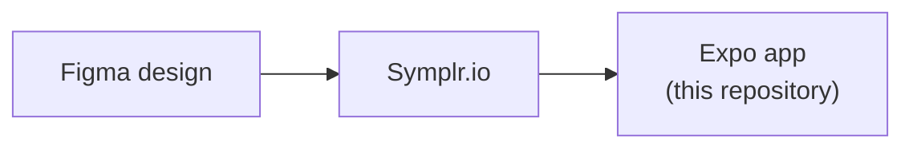

<div align="center">

<a href="https://symplr.io">
  <picture>
    <source media="(prefers-color-scheme: dark)" srcset="docs/symplr-logo-dark.png">
    
  </picture>
</a>

# Food Couriers

**A food-delivery app generated by [Symplr.io](https://symplr.io) from a Figma design.**<br>
Real Expo React Native source code, in strict TypeScript, running against a live backend.

[](https://sonarcloud.io/summary/overall?id=Symplr-io_food-couriers-demo)
[](https://sonarcloud.io/component_measures?id=Symplr-io_food-couriers-demo&metric=coverage)
[](https://github.com/Symplr-io/food-couriers-demo/actions/workflows/quality.yml)
[](https://github.com/Symplr-io/food-couriers-demo/actions/workflows/demo-health.yml)
[](LICENSE)


</div>

## Try it on your phone


1. Install [Expo Go](https://play.google.com/store/apps/details?id=host.exp.exponent) on an Android phone.
2. Scan the QR code, or open `exp://demo-food-couriers.symplr.io` in Expo Go.
3. Sign in as `demo@symplr.io` with the password `Demo-oGOPNuE_gFVt`.

Browse the menu, add dishes to the cart, place an order and rate the driver.
The demo data resets every 30 minutes. Expo Go on iPhone cannot open it yet.

<br clear="right">

## Made with Symplr.io



Symplr.io turned the Figma design into the app in [`apps/food-couriers`](apps/food-couriers):

- **12 screens** from the Figma frames, with navigation and deep links.
- **A typed data layer:** TanStack Query hooks, Zod-checked responses, and
  Supabase Auth and PostgREST behind them.
- **Design tokens** taken from Figma, with NativeWind for code you add.
- **Quality built in:** 533 unit tests, ESLint, strict TypeScript, and the
  CI and SonarQube Cloud setup.

A few small fixes were made by hand after generation. Each one is its own
commit in the history.

**Have a design of your own? [Turn it into an app at symplr.io →](https://symplr.io)**

## For developers


Run it yourself with Node 20 and Expo Go:

```bash
git clone https://github.com/Symplr-io/food-couriers-demo.git
cd food-couriers-demo/apps/food-couriers
npm ci
npm start        # then scan the QR code in the terminal with Expo Go
```

The phone and the computer need to be on the same network.

The app uses the demo backend in its committed `.env`, so the demo account above works locally too.

| Command | What it does |
| --- | --- |
| `npm start` | Starts the Expo dev server |
| `npm run typecheck` | Type-checks with `tsc` |
| `npm run lint` | Runs ESLint |
| `npm test` | Runs the Jest unit tests |
| `npm run test:coverage` | Runs the tests and writes the coverage report |

| Path | What is there |
| --- | --- |
| [`apps/food-couriers`](apps/food-couriers) | The app: generated code in `src/gen`, your own code in `src/custom` |
| [`supabase/demo-reset.sql`](supabase/demo-reset.sql) | The demo account, its sample data and the 30-minute reset |
| [`.github/workflows`](.github/workflows) | The quality checks on every push, and a demo health check every 15 minutes |

## Quality

Every push to `main` runs these checks:

| Type check | Lint | Unit tests | Coverage | SonarQube Cloud |
| :---: | :---: | :---: | :---: | :---: |
| 0 errors | 0 errors | 533 passing | 76% | Quality gate passed, A ratings |

## Credits

The UI comes from
["Food Couriers - Food Delivery App - UI/UX Design Case Study"](https://www.figma.com/community/file/1205134361239673955)
by El Kamcy Speaks, which is licensed under [CC BY 4.0](https://creativecommons.org/licenses/by/4.0/).
Some images in the design come from third parties and belong to their owners.

The code is released under the [MIT License](LICENSE).
