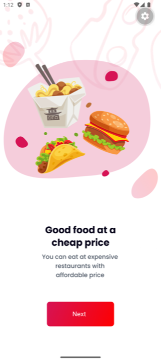
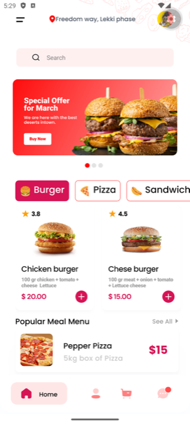
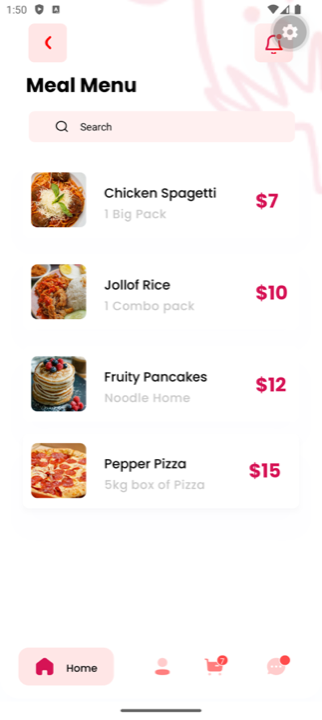
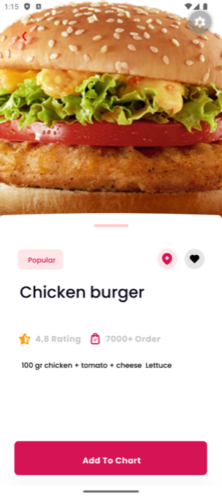
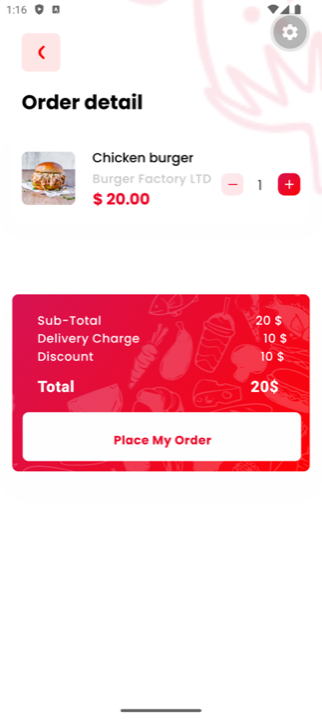
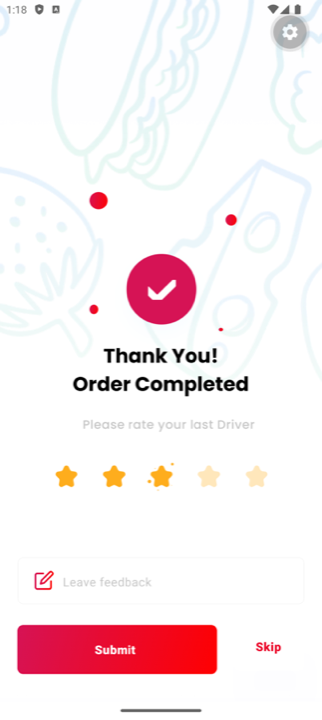

# Food Couriers — a Symplr demo app

Food Couriers is a food-delivery app that [Symplr](https://symplr.io) generated
from a Figma design. It is a real Expo (SDK 58) React Native app, written in
strict TypeScript, and it talks to a live backend. You can run it on your own
phone in a minute, with nothing to install but Expo Go.

The source is in [`apps/food-couriers`](apps/food-couriers).

## Try it on your Android phone

1. Install [Expo Go](https://play.google.com/store/apps/details?id=host.exp.exponent).
2. Scan this code with the phone's camera or with Expo Go's "Scan QR code":

   

   or, in Expo Go, Enter URL manually: `exp://demo-food-couriers.symplr.io`.
3. Sign in as `demo@symplr.io` with the password `Demo-oGOPNuE_gFVt`. The demo
   resets every 30 minutes.

Android only for now: Expo Go on iPhone cannot open it.

## Screenshots

| Onboarding | Home | Meal menu |
| :---: | :---: | :---: |
|  |  |  |
| **Meal detail** | **Cart** | **Order completed** |
|  |  |  |

## What you can do in the demo

- **Onboarding:** swipe through the intro, or skip it.
- **Sign in:** email and password through Supabase Auth, on a screen that
  switches between Create Account and Login.
- **Browse:** the home feed shows a special-offer banner, popular dishes and
  the popular meal menu, all loaded from the database. Search filters dishes
  by any field, on Home and on the Meal Menu.
- **Order:** open a dish, add it to the cart, change quantities and see the
  totals, then place the order. The cart badge counts what is in the cart.
- **Rate:** once an order is complete, rate the driver and leave feedback.
- **Profile:** see the signed-in account.

Every visitor shares the one demo account. Each user's rows are protected by
row-level security, and a scheduled job puts the sample data back every 30
minutes.

## How it is built

| | |
| --- | --- |
| Generated by | Symplr, from a Figma Community design: 12 screens, about 18,000 lines of TypeScript |
| Runtime | Expo SDK 58, React Native 0.88, Hermes |
| Language | TypeScript, `strict` mode |
| Navigation | React Navigation 7, with deep links checked against the real screens |
| Data | TanStack Query hooks for every API operation, with responses validated by Zod |
| Backend | Supabase: Auth, and PostgREST with row-level security |
| Styling | Design tokens generated from Figma, plus NativeWind for hand-written code |

## Quality

Every push to `main` runs the [Quality workflow](.github/workflows/quality.yml):

| Check | Tool | Result |
| --- | --- | --- |
| Type check | `tsc --noEmit`, strict mode | 0 errors |
| Lint | ESLint with `@react-native/eslint-config` | 0 errors |
| Unit tests | Jest and React Test Renderer | 533 tests in 34 suites, all passing |
| Coverage | Jest | 74.8% of lines and 72.6% of statements, across all of `src/` |
| Static analysis | SonarQube Cloud | Quality gate, bugs, vulnerabilities and maintainability in the badges above |
| Secret scan | `npm run check:secrets` | No secrets found |
| Dependency audit | `npm audit` | Advisory only: the findings are in the Expo, Metro and Tailwind toolchain |

There is one Jest suite per screen. Each one mounts the screen inside the real
navigator and fires every handler the screen renders. Logic suites cover the
API services, form validation, response rules and formatting. Twelve
[Maestro](https://maestro.mobile.dev) end-to-end flows sit in
`apps/food-couriers/.maestro`, but CI does not run them.

SonarQube Cloud analyses the app on every push. It uses the scope set in
[`sonar-project.properties`](apps/food-couriers/sonar-project.properties), and
that file explains each exclusion. Its coverage figure covers the shared
runtime the screens are built from, not every file, so it is higher than
Jest's figure for the whole of `src/` in the table above.

### Changes made after generation

The app is Symplr's output with these commits on top:

- the login screen validates only the tab that is showing (since fixed in the
  generator);
- buttons the design draws but does not wire up now work (the "demo patch");
- fixes so the app builds cleanly on Expo SDK 58:
  - React Native 0.88 types: three type errors;
  - the ESLint setup, which was missing its dependencies and used the wrong
    config path;
  - two test suites that tested modules this app does not include.

## Repository layout

| Path | What it is |
| --- | --- |
| [`apps/food-couriers`](apps/food-couriers) | The app |
| [`supabase/demo-reset.sql`](supabase/demo-reset.sql) | The demo account, its sample data and the 30-minute reset |
| [`.github/workflows/quality.yml`](.github/workflows/quality.yml) | Type check, lint, tests, coverage and SonarQube Cloud |
| [`.github/workflows/demo-health.yml`](.github/workflows/demo-health.yml) | Every 15 minutes, checks that the demo still serves and signs in |

## Credits

The UI is based on
["Food Couriers - Food Delivery App - UI/UX Design Case Study"](https://www.figma.com/community/file/1205134361239673955)
by El Kamcy Speaks. It is published on Figma Community under the
[CC BY 4.0](https://creativecommons.org/licenses/by/4.0/) licence.

The design was converted to a React Native app, and its sample names and email
addresses were replaced with the demo account's.

Some images in the design come from third-party sources. They are not covered
by the design's licence and belong to their respective owners.
